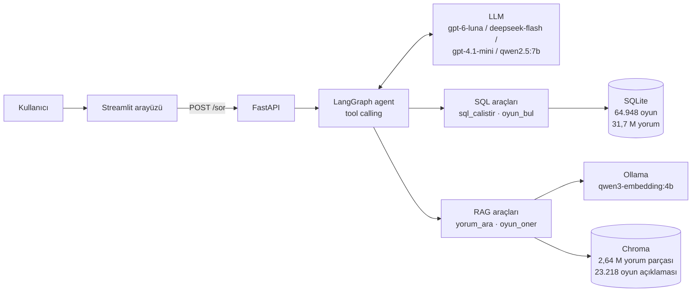

# 🎮 Steam Oyun Analiz Asistanı

Steam oyun verisi ve **31,8 milyon oyuncu yorumu** üzerinde **Türkçe soru-cevap** yapan bir LLM agent'ı.
Sayısal soruları **SQL** yazarak, "oyuncular ne düşünüyor?" sorularını **RAG** (anlamsal yorum araması) ile cevaplıyor; ikisini birden gerektiren soruları agent kendisi planlıyor. Her cevabın altında "bu cevaba nasıl ulaştık?" bölümü var: çalışan SQL sorguları ve kullanılan yorumlar görünüyor.

> *A Turkish-language LLM agent that answers questions about Steam games by combining text-to-SQL (SQLite) and RAG over 2.6M review chunks (Chroma), evaluated on a 30-question benchmark across 4 LLMs. FastAPI + Streamlit, runs locally with Docker.*

## 🎬 Demo

https://github.com/user-attachments/assets/97b9a328-584d-4880-a627-2916c612a519

---

## Ne sorabilirsin?

| Soru | Agent ne yapıyor |
|---|---|
| "Baldur's Gate 3'ün puanı ve oy sayısı nedir?" | `oyun_bul` ile oyunu bulur → `sql_calistir` ile oranı çeker |
| "The Sims 4'ü oyuncular seviyor mu?" | SQL'den genel oran + `yorum_ara(ozetle)` ile olumlu/olumsuz yorumların özeti |
| "Elden Ring'i eleştirenler neden şikâyet ediyor?" | `yorum_ara(konu)` ile olumsuz yorumlarda anlamsal arama |
| "Arkadaşlarla oynanacak online co-op korku oyunu öner." | `oyun_oner` ile oyun açıklamalarında anlamsal arama + SQL ile puan sıralaması |
| "En çok Türkçe yorum alan oyunlar hangileri?" | Tek bir SQL sorgusu |

## Mimari



- **Sayılar SQLite'ta, metinler Chroma'da.** Oranlar örneklenmiş yorumlardan değil, Steam'in toplam olumlu/olumsuz sayılarından hesaplanıyor. İki depo `app_id` ve `review_id` ile bağlı.
- **SQL aracı:** salt okunur bağlantı, sadece `SELECT`, 10 sn zaman aşımı, en fazla 50 satır. Oyun adları `oyun_bul` ile (rapidfuzz) önce `app_id`'ye çevriliyor.
- **RAG aracı, 3 mod:**
  - `konu`: soruya anlamca en yakın yorumlar; mesafe 0,45'in üstündeyse "ZAYIF EŞLEŞME" uyarısı.
  - `ozetle`: genel bir sorguya en yakın yorumlardan faydalı oya göre seçim; olumlu ve olumsuz ayrı gruplarda.
  - `hepsi`: eşiği geçen bütün yorumlar + LLM ile etiketleme; sayımı SQL/Python yapar.
- **Embedding:** `qwen3-embedding:4b`, 1024 boyut, yerel GPU'da (Ollama). 4 model arasında yapılan kalite testinde en iyisi (%82,9 isabet, bge-m3 %67,1, OpenAI 3-small %44,3).

## Sonuçlar: 4 model, 30 soru

30 soru (sayısal, yorum, karma, öneri, tuzak ve kapsam dışı) her modelde aynı araçlar, aynı talimat ve aynı embedding ile çalıştırıldı. Cevapları iki ayrı LLM hakem 0–2 arası puanladı.

| model | puan (hakem 1: gpt-6.1-terra, 3 tekrar) | puan (hakem 2: Claude, 1. tekrar) | uydurma (hakem 1 / hakem 2) | $ / 30 soru* |
|---|---|---|---|---|
| **gpt-6-luna** (varsayılan) | **1,39** | **1,67** | **%21 / %0** | 0,060 |
| deepseek-flash | 1,26 | 1,60 | %61 / %30 | 0,086 |
| gpt-4.1-mini | 1,14 | 1,30 | %39 / %13 | 0,158 |
| qwen2.5:7b (yerel) | 0,13 | 0,13 | %81 / %63 | 0 |

\*≈ ölçülen token × liste fiyatı. Projenin tüm OpenAI faturası (geliştirme + değerlendirme + hakem) **$4,35** oldu.

- İki hakemin sıralaması aynı: Luna ≈ DeepSeek > mini ≫ qwen 7B.
- DeepSeek araç seçiminde kusursuz (%100) ama doğru veriyi çektikten sonra dayanaksız yorum ekleyebiliyor.
- 7B yerel model çoğu soruda araç çağırmadan cevap verdi; bu karmaşıklıkta bir agent'ı yürütemiyor.
- Arayüzde model seçilebilir; varsayılan **gpt-6-luna**.

Ayrıntılar: [`notebooks/08_degerlendirme.ipynb`](notebooks/08_degerlendirme.ipynb), [`notebooks/09_model_karsilastirma.ipynb`](notebooks/09_model_karsilastirma.ipynb), [`reports/`](reports/).

## Bilinen sınırlamalar

- Veri setinde bazı popüler oyunların yorum dosyası eksik (ör. The Sims 4'ün 153 bin oyuna karşı 9 bin yorumu var). Oran bu yüzden yorumlardan değil, Steam toplamlarından alınıyor.
- Chroma'ya oyun başına en fazla 200 yorum girdi. Az yorumlu konularda RAG cevapları örneklemle sınırlı.
- Şaka/meme yorumları faydalı oy alabildiği için `ozetle` moduna sızabiliyor.
- LLM hakemler elle puanlamayla karşılaştırılarak kalibre edilmedi. İki farklı hakem kullanılması bu riski kısmen azaltıyor.

---

## Kurulum

### Gereksinimler
- Python 3.12
- [Ollama](https://ollama.com) (embedding için): `ollama pull qwen3-embedding:4b`
  (yerel LLM denemek istersen `ollama pull qwen2.5:7b`; bağlam için `OLLAMA_CONTEXT_LENGTH=32768`)
- En az bir LLM API anahtarı (varsayılan model için OpenAI)
- **Disk ~60 GB, RAM 24 GB önerilir** (Chroma indeksi bellekte ~11 GB)

### 1. Repoyu klonla ve ayarları yap
```bash
git clone https://github.com/kaanaydin02/steam-oyun-asistani.git
cd steam-oyun-asistani
cp .env.example .env      # anahtarlarını .env içine yaz
```

### 2. Veri
Veri bu repoda **yok** (ham veri 10,5 GB, üretilen veritabanları ~44 GB).
1. [Steam Games Metadata and Player Reviews (2020–2024)](https://data.mendeley.com/datasets/jxy85cr3th) veri setini indir.
2. `games.json` dosyasını `data/raw/` klasörüne, yorum CSV'lerini `data/raw/reviews/` klasörüne koy.
3. Notebook'ları sırayla çalıştır:

| notebook | ürettiği |
|---|---|
| `01_veri_kesfi` | veri kalitesi bulguları |
| `02_alt_kume_ve_temizlik` | `data/processed/*.parquet` (temiz oyun tabloları, dil tespiti yapılmış yorumlar) |
| `03_sqlite` | `data/processed/steam.db` |
| `04_sql_araci` | SQL aracı (sonra `src/sql_araci.py`) |
| `05_embedding_ve_chroma` | `data/chroma_v2` (embedding scriptleri `src/` altında) |
| `06_rag_araci` | `data/processed/chroma_parca_esleme.parquet` |
| `07`–`09` | agent, değerlendirme, model karşılaştırması |

> ⚠️ 2,64 M yorum parçasının embedding'i tek bir yerel GPU'da (RX 7900 XT) saatler sürüyor. Script kesintiye dayanıklı: kaldığı bloktan devam ediyor.

### 3a. Docker ile çalıştır (önerilen)
Veri imajın içine **girmez**; `data/` klasörü dışarıdan bağlanır. Ollama host makinede çalışır, konteyner ona `host.docker.internal` ile ulaşır.
```bash
docker compose up --build
```
- Arayüz: http://localhost:8501
- API dokümantasyonu: http://localhost:8000/docs

API açılışta Chroma'yı ısıtıyor (~30 sn – 3 dk). Arayüz, API hazır olunca otomatik açılıyor.

### 3b. Docker'sız çalıştır
```bash
python -m venv .venv && source .venv/bin/activate
pip install -r requirements.txt
uvicorn src.api:app --port 8000          # 1. terminal
streamlit run arayuz/app.py              # 2. terminal
```

### API örneği
```bash
curl -X POST http://localhost:8000/sor \
  -H "Content-Type: application/json" \
  -d '{"soru": "Cyberpunk 2077 kaç oy almış ve olumlu oranı nedir?"}'
```
Uç noktalar: `GET /saglik`, `GET /modeller`, `POST /sor`. Aynı `oturum` değeri gönderilirse sohbet hafızası korunur.

## Proje yapısı
```
├── notebooks/        01–09: veri keşfinden model karşılaştırmasına her aşama
├── src/
│   ├── ayarlar.py        yollar ve sabitler
│   ├── sql_araci.py      sql_calistir, oyun_bul
│   ├── rag_araci.py      yorum_ara (konu/ozetle/hepsi), oyun_oner
│   ├── araclar.py        araç tanımları + tek giriş noktası
│   ├── talimat.py        sistem talimatı
│   ├── llm.py            OpenAI / DeepSeek / Gemini / Ollama için tek istemci
│   ├── agent_graf.py     LangGraph agent (oturum hafızası)
│   ├── degerlendirme.py  30 soruluk değerlendirme + LLM hakem
│   └── api.py            FastAPI
├── arayuz/app.py     Streamlit arayüzü
├── reports/          soru seti, çalıştırma kayıtları, hakem puanları, grafikler
├── Dockerfile
└── docker-compose.yml
```

## Teknolojiler
Python · pandas · SQLite · Chroma · Ollama (qwen3-embedding:4b) · OpenAI uyumlu API'ler (OpenAI, DeepSeek, Gemini, Ollama) · LangGraph · FastAPI · Streamlit · Docker · fastText (dil tespiti) · rapidfuzz

## Gelecek çalışma
- Google Cloud Run'a deploy (Secret Manager ile anahtar yönetimi). Chroma'yı yönetilen bir vektör veritabanına taşımak.
- `hepsi` modundaki etiketlemeyi yerel bir modelle (qwen2.5:14b) yapmak.
- LLM hakemi elle puanlanmış bir alt kümeyle kalibre etmek.

## Veri ve lisans
- **Veri:** *Steam Games Metadata and Player Reviews (2020–2024)*, Mendeley Data, [CC BY 4.0](https://creativecommons.org/licenses/by/4.0/). Kaynak: https://data.mendeley.com/datasets/jxy85cr3th. Veri bu repoda dağıtılmıyor. Kullanıcı adı sütunu işleme sırasında atıldı.
- **Kod:** [MIT](LICENSE)

---
Bitirme projesi · Workintech Data Scientist AI Pro · Kaan Aydın
